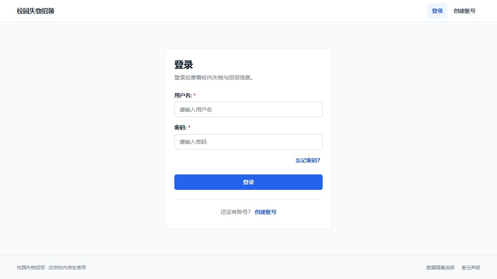
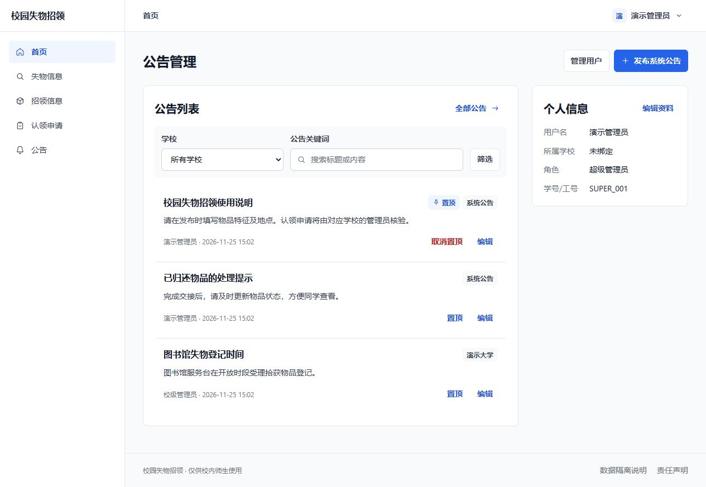
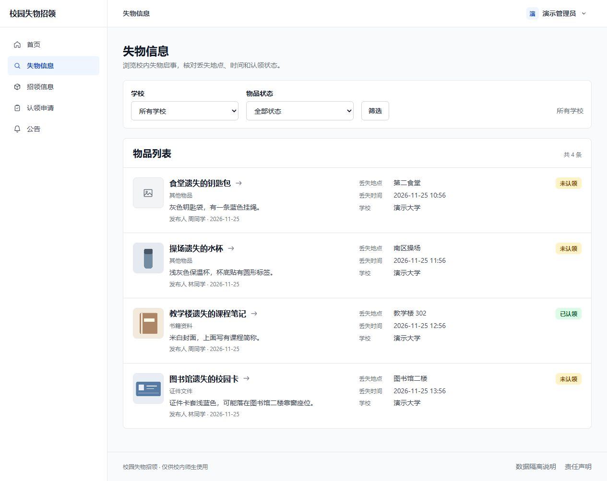
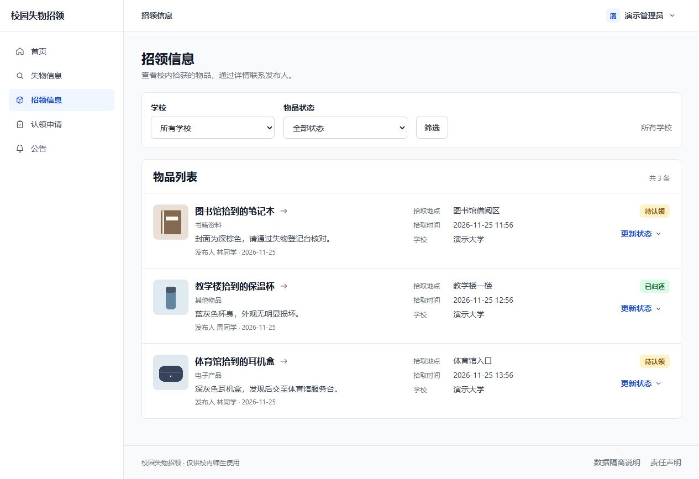
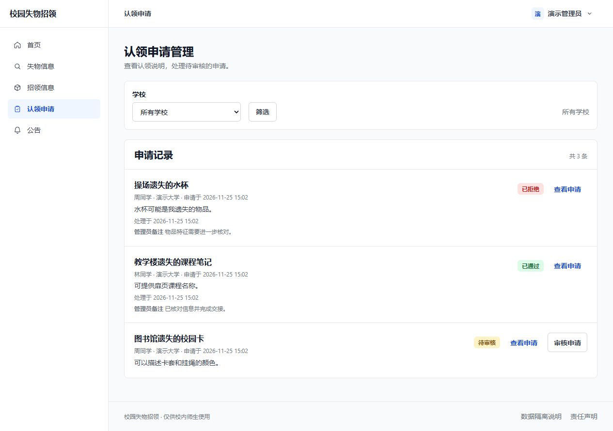
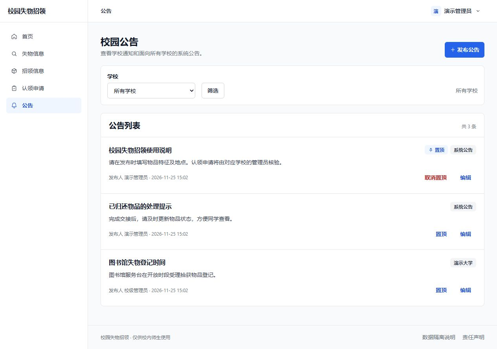
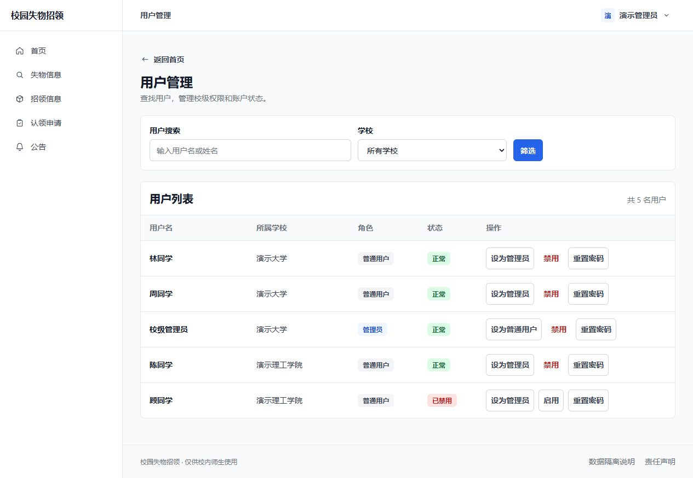

# 校园失物招领系统

面向校园的失物招领平台。学生可发布失物和招领信息、上传图片、提交认领申请。校级管理员审核本校申请并发布公告，超级管理员可管理学校范围和用户。

项目使用 Django 模板渲染页面，部署时使用 MySQL 保存业务数据。

## 本地部署

需要 Python 3.12 或 3.13、MySQL 8.x 和 Git。以下命令在项目根目录执行。

### 1. 获取代码并安装依赖

把 `YOUR_GITHUB_REPOSITORY_URL` 换成仓库的克隆地址。已经下载源代码时，直接进入项目根目录即可。

```sh
git clone YOUR_GITHUB_REPOSITORY_URL campus-lostfound
cd campus-lostfound
python -m venv .venv
```

Windows PowerShell

```powershell
.\.venv\Scripts\python.exe -m pip install -r requirements.txt
Copy-Item .env.example .env
```

macOS 或 Linux

```sh
source .venv/bin/activate
python -m pip install -r requirements.txt
cp .env.example .env
```

Windows 用户请在后续命令中使用 `.\.venv\Scripts\python.exe`，以确保 Django 使用刚安装的项目依赖。

### 2. 建立 MySQL 数据库

用 MySQL 管理员登录执行以下 SQL。执行前把示例密码替换成独立生成的强密码。

```sql
CREATE DATABASE campus_lostfound
  CHARACTER SET utf8mb4 COLLATE utf8mb4_unicode_ci;

CREATE USER 'campus_app'@'127.0.0.1' IDENTIFIED BY 'REPLACE_WITH_YOUR_PASSWORD';

GRANT ALL PRIVILEGES ON campus_lostfound.*
  TO 'campus_app'@'127.0.0.1';
```

### 3. 配置环境变量

编辑本地的 `.env`，填写 `DJANGO_SECRET_KEY` 和 `MYSQL_PASSWORD`。如果数据库名称、账号、主机或端口与示例不同，一并更新相应的 `MYSQL_*` 项。

用下面的命令生成 Django 密钥，把结果用单引号包在 `DJANGO_SECRET_KEY=` 后面。数据库密码也可用单引号包起来。

```sh
python -c "from django.core.management.utils import get_random_secret_key; print(get_random_secret_key())"
```

进程环境里已设置的变量优先于 `.env`。本地开发可沿用示例里的 `DJANGO_DEBUG=true` 和回环地址。真实密钥和数据库密码请保存在本机 `.env` 或部署平台的环境变量里。

如果站点有公开的密码找回联系邮箱，可填写 `CAMPUS_SUPPORT_EMAIL`。留空时，页面会提示联系所在学校的管理员。

### 4. 迁移、初始化和启动

Windows PowerShell

```powershell
.\.venv\Scripts\python.exe manage.py migrate
.\.venv\Scripts\python.exe manage.py seed_schools
.\.venv\Scripts\python.exe manage.py createsuperuser
.\.venv\Scripts\python.exe manage.py runserver
```

macOS 或 Linux

```sh
python manage.py migrate
python manage.py seed_schools
python manage.py createsuperuser
python manage.py runserver
```

打开 [本地站点](http://127.0.0.1:8000/)。超级管理员可使用刚创建的账号登录。普通用户通过注册页面搜索并选择所属学校。

`seed_schools` 导入 83 所学校的名称和代码。重复执行会跳过已有代码，并保留现有学校信息。站点数据库通过迁移创建，学校通过此命令初始化。

## 部署到服务器

- 在服务器环境变量中配置独立的数据库账号和密钥，设置 `DJANGO_DEBUG=false`，将 `DJANGO_ALLOWED_HOSTS` 改为实际域名。需要额外的 CSRF 信任来源时，在 `DJANGO_CSRF_TRUSTED_ORIGINS` 中填完整来源，例如 `https://campus.example.org`。
- 执行 `python manage.py migrate` 和 `python manage.py collectstatic --noinput`。第一次部署时，再初始化学校并创建管理员。
- 使用生产级 WSGI 或 ASGI 服务运行应用，并通过反向代理提供 HTTPS。静态资源由 `staticfiles/` 提供，上传图片存于 `media/`，部署时为上传目录配置持久存储并纳入备份。
- 上线前运行 `python manage.py check --deploy`，逐项核对实际部署配置。当前管理员重置密码功能使用固定初始密码，公网启用该功能前需要另行处理。

[查看 Django 部署检查清单](https://docs.djangoproject.com/en/5.2/howto/deployment/checklist/)

## 本地数据与版本控制

`.env`、数据库备份和 `media/` 会保留在各自的部署环境。公开仓库包含 `.env.example`、学校初始化数据和 `img/` 中的演示截图。

## 常见问题

- **提示 `No module named 'dotenv'`**。请用项目的 Python 启动 Django。Windows 下可先用 `.\.venv\Scripts\python.exe -m pip install -r requirements.txt` 补齐依赖，再运行 `.\.venv\Scripts\python.exe manage.py runserver`。在 IDE 里运行时，将项目和运行配置的解释器指向 `.venv\Scripts\python.exe`。
- **数据库连接失败**。检查 MySQL 是否启动，并核对库名、用户名、密码、主机和端口。
- **注册时学校列表为空**。先执行迁移，再运行 `python manage.py seed_schools`。
- **站点里看不到旧的物品照片**。页面展示的是本部署环境中新上传的图片。README 截图位于 `img/`。

## 界面预览

以下为使用演示账号和演示记录拍摄的当前界面。

| 登录 | 系统管理首页 |
| --- | --- |
|  |  |

| 失物信息 | 招领信息 |
| --- | --- |
|  |  |

| 认领申请 | 公告 |
| --- | --- |
|  |  |

| 用户管理 |
| --- |
|  |
